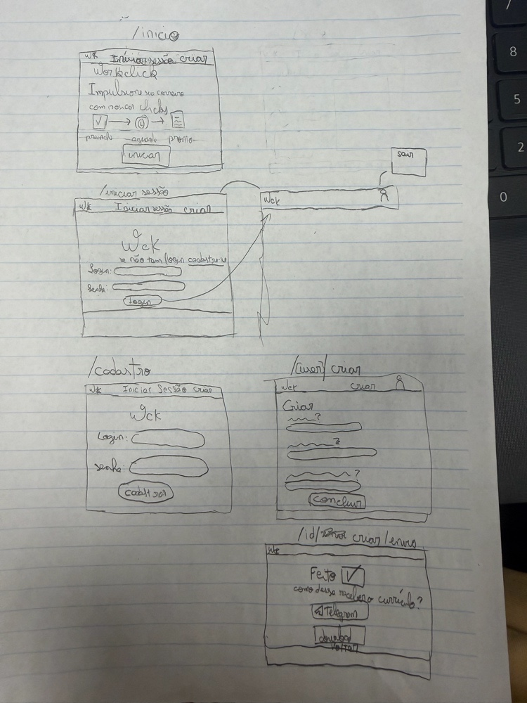

# Worclick - Evolução do projeto

## Objetivo desta etapa

O projeto anterior, na pasta `1_projeto_lagarta`, apresenta o Worclick em HTML, CSS e JavaScript. Nesta etapa, a interface está sendo migrada para React com Next.js: o foco é construir as telas do wireframe, adaptar a experiência para celular e permitir a navegação entre elas.

O wireframe a seguir registra a jornada proposta: a pessoa chega à página inicial, pode entrar ou se cadastrar, preenche o currículo e chega às opções de recebimento. Nesta etapa, os campos e as telas são apenas a interface: não há autenticação, tratamento ou armazenamento dos dados, geração do documento ou envio para o celular.

## Wireframe da jornada



O esboço conecta cinco momentos do uso: apresentação do Worclick, início de sessão, cadastro, preenchimento do currículo e conclusão. Essa sequência dá contexto às rotas e às alterações descritas a seguir. A interface React implementada segue esses momentos; geração e envio são etapas futuras.

## O que será acrescentado

- Páginas responsivas para início, sessão, cadastro, preenchimento do currículo e conclusão.
- Navegação entre as telas com o roteamento do Next.js.
- Campos organizados pelos mesmos grupos de informação do formulário HTML original.
- Indicação visual de que download e envio para o celular ainda serão implementados.

## Migração para React

A migração parte dos arquivos `index.html`, `style.css` e `script.js` da pasta `1_projeto_lagarta`. Em vez de concentrar toda a interface em um único documento, o Next.js organiza cada tela em um arquivo `page.js` dentro de uma pasta de rota. O componente `layout.js` compartilha o cabeçalho, a navegação e o rodapé entre essas páginas.

| Projeto HTML/CSS/JS | Projeto React/Next.js |
| --- | --- |
| `index.html` e seus blocos de conteúdo | `src/app/page.js` para o início e páginas próprias para cada rota |
| Elementos repetidos do cabeçalho | `src/app/components/Navegacao.js`, incluído pelo layout compartilhado |
| Campos do formulário no HTML | Grupos de campos renderizados em `src/app/curriculo/page.js` |
| `style.css` | `src/app/globals.css` para regras globais e `src/app/page.module.css` para estilos das telas |
| Links e navegação da página única | `next/link` e pastas do App Router |
| `script.js` para validar dados e gerar Word | Não migrado nesta etapa; geração, validação e processamento continuam fora do escopo |

O visual também foi aproximado do original: o azul `#0056b3` permanece como cor principal, com fundo cinza-claro, áreas de conteúdo brancas, campos com bordas neutras e rodapé grafite. A home conserva a apresentação do Worclick e exemplos visuais de currículo; no formulário, os campos seguem em uma coluna e os modelos aparecem como prévias estáticas. Os controles para adicionar experiências, formações e projetos estão desativados porque ainda não existe lógica para duplicar ou tratar esses dados.

O App Router associa a pasta ao endereço: `src/app/sessao/page.js` atende `/sessao`; `src/app/cadastro/page.js` atende `/cadastro`; `src/app/curriculo/page.js` atende `/curriculo`; e `src/app/curriculo/concluido/page.js` atende `/curriculo/concluido`. Os componentes de página são React e a navegação usa `Link`, sem recarregar o documento inteiro.

Os formulários de sessão, cadastro e currículo são apresentações visuais. Os links de continuidade demonstram o percurso entre as telas, mas não validam credenciais nem transportam ou salvam o conteúdo digitado. Na conclusão, as opções de baixar e receber o currículo aparecem como próximas etapas, sem executar essas ações.

## 1. Rotas do site

As rotas abaixo representam telas da aplicação. Elas não carregam identificadores ou outros valores na URL; os dados do usuário e do currículo serão tratados na sessão ou enviados no corpo das requisições.

| Rota | Tela | Comportamento |
| --- | --- | --- |
| `/` | Início do site | Apresenta o Worclick e oferece acesso para iniciar uma sessão ou criar um currículo. |
| `/sessao` | Iniciar sessão | Permite que quem já tem cadastro acesse a criação do currículo. |
| `/cadastro` | Cadastro | Permite criar uma conta, conforme as regras de acesso que forem definidas para o projeto. |
| `/curriculo` | Criar currículo | Apresenta o formulário para preencher e revisar os dados profissionais. |
| `/curriculo/concluido` | Conclusão | Apresenta as opções de baixar o documento ou solicitar o envio para um celular. |

O roteador deve associar cada caminho a uma tela e indicar uma tela de não encontrado para caminhos inválidos. Ao acessar diretamente uma dessas rotas, o servidor de hospedagem também deverá entregar a aplicação; caso contrário, a atualização do navegador pode resultar em erro 404.

As rotas não substituem o controle de acesso. Se a criação do currículo exigir uma sessão iniciada, a aplicação verificará esse estado antes de abrir `/curriculo` e direcionará a pessoa sem sessão para `/sessao` ou `/cadastro`. Como as URLs não têm parâmetros, informações como o número de telefone não devem ser colocadas no caminho.

## 2. Navegação das telas

1. A pessoa acessa `/` e escolhe iniciar uma sessão ou fazer o cadastro.
2. Em `/sessao` ou `/cadastro`, encontra os campos visuais de acesso e segue para `/curriculo` pelos links da interface.
3. Em `/curriculo`, percorre os campos de dados pessoais, experiência, formação, projetos e competências.
4. O link de conclusão abre `/curriculo/concluido`, onde as opções de download e recebimento são exibidas como indisponíveis nesta etapa.

Os valores digitados não são enviados nem persistidos. A navegação é demonstrativa; não há controle de sessão ou restrição de acesso entre as páginas.

## 3. Próximas etapas: geração e envio

O projeto anterior gera um documento no navegador. Essa lógica ainda precisa ser adaptada para React e conectada à ação de download. O envio para celular exigirá uma API no servidor; o navegador não deverá chamar diretamente a API privada do provedor de mensagens nem expor credenciais.

Uma proposta de endpoint do próprio projeto é:

```http
POST /api/curriculos/enviar
Content-Type: multipart/form-data
```

O corpo da requisição pode conter o número de celular e o arquivo do currículo, por exemplo nos campos `telefone` e `curriculo`. O caminho do endpoint é fixo e não possui parâmetro; os dados variáveis seguem no corpo da requisição. Essa API é diferente das rotas de tela `/`, `/sessao` e `/curriculo`.

Quando essa integração for implementada, o servidor deverá:

1. Verificar se o telefone e o arquivo foram enviados e se o formato e o tamanho do documento são permitidos.
2. Normalizar e validar o número, incluindo código do país e DDD.
3. Confirmar que o envio foi solicitado pelo usuário e respeitar os limites do serviço integrado.
4. Encaminhar o documento por uma API de mensagens, como a WhatsApp Business Platform, conforme as regras e configurações da conta do projeto.
5. Responder com um status adequado, sem expor credenciais nem dados pessoais desnecessários.

O formato da mensagem e a configuração do provedor serão definidos nessa etapa futura. O site deverá preservar uma alternativa de download e oferecer nova tentativa em caso de falha.

## 4. Organização do front-end

### React e rotas

- `layout.js` compartilha navegação e rodapé; `Navegacao.js` concentra os links principais.
- Cada tela tem seu próprio `page.js`, seguindo a estrutura de pastas do App Router.
- `Acesso.js` reaproveita a composição visual entre início de sessão e cadastro.
- A página de currículo organiza os campos em grupos temáticos e mantém rótulos associados aos controles.

### CSS

- `globals.css` define a base visual, tipografia, cores e normalização dos elementos.
- `page.module.css` reúne os estilos das telas, formulários, navegação e estados responsivos.
- As páginas adaptam os exemplos, os grupos do formulário e as ações para telas estreitas, preservando a organização visual do projeto original.

### Limites desta versão

- Não há tratamento, validação, armazenamento ou envio dos campos.
- A tela de conclusão não baixa um arquivo nem solicita o número de celular.
- Login e cadastro não autenticam usuários; os links servem apenas para percorrer a interface.

## 5. Privacidade e segurança nas próximas etapas

Currículos contêm dados pessoais. O projeto deve solicitar somente os dados necessários, informar a finalidade do telefone, obter confirmação antes do envio e limitar o tempo de armazenamento do arquivo. O documento não deve ficar disponível em um endereço público previsível. A comunicação com o servidor e com o provedor deve usar HTTPS, e as credenciais da integração devem permanecer no servidor.

Antes de disponibilizar o envio, também será necessário verificar as regras atuais do provedor escolhido, incluindo consentimento, formatos aceitos e eventuais modelos de mensagem exigidos.

## 6. Verificações desta etapa

- Acessar diretamente `/`, `/sessao`, `/cadastro`, `/curriculo` e `/curriculo/concluido`.
- Percorrer os links da página inicial, alternar entre sessão e cadastro e avançar até o formulário.
- Confirmar que o formulário apresenta todos os grupos de campos e que a página final identifica as ações futuras.
- Conferir as prévias estáticas dos modelos e os controles de adição desativados.
- Verificar a leitura e o uso dos campos em larguras de celular e desktop.
- Confirmar que os campos não são enviados, persistidos ou processados nesta versão.
