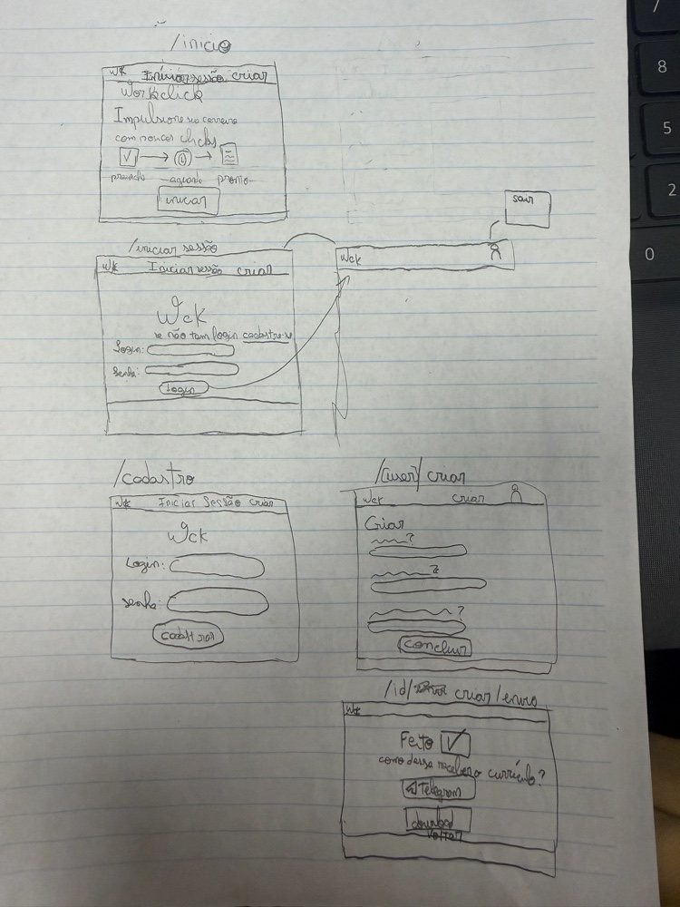

# Worclick - Evolução do projeto

## Objetivo desta etapa

O projeto anterior, na pasta `1_projeto_lagarta`, apresenta o Worclick em HTML, CSS e JavaScript. Nesta etapa, a interface está sendo migrada para React com Next.js: o foco é construir as telas do wireframe, adaptar a experiência para celular e permitir a navegação entre elas.

O formulário agora valida campos obrigatórios e formatos no navegador, permite adicionar e remover experiências profissionais e salva um único currículo no armazenamento local do navegador. Na página de conclusão, uma API gera um documento Word para download. Não há opção de envio por Telegram ou por outro serviço de mensagens.

## Wireframe da jornada



O esboço conecta cinco momentos do uso: apresentação do Worclick, início de sessão, cadastro, preenchimento do currículo e conclusão. Essa sequência dá contexto às rotas e às alterações descritas a seguir. A interface React implementada segue esses momentos, e a conclusão permite baixar o currículo gerado pela API.

## O que esta etapa inclui

- Páginas responsivas para início, sessão, cadastro, preenchimento do currículo e conclusão.
- Navegação entre as telas com o roteamento do Next.js.
- Campos organizados pelos mesmos grupos de informação do formulário HTML original, com validação nativa dos campos obrigatórios e dos formatos de e-mail e URL.
- Inclusão e remoção de experiências profissionais; ao começar a preencher uma experiência, todos os campos dessa entrada tornam-se obrigatórios.
- Salvamento de um único currículo no armazenamento local do navegador. Um novo salvamento substitui o anterior.
- Geração de um documento Word pela API e download na página de conclusão.

## Migração para Next.js

A migração parte dos arquivos `index.html`, `style.css` e `script.js` da pasta `1_projeto_lagarta`. Em vez de concentrar toda a interface em um único documento, o Next.js organiza cada tela em um arquivo `page.js` dentro de uma pasta de rota. O componente `layout.js` compartilha o cabeçalho, a navegação e o rodapé entre essas páginas.

| Projeto HTML/CSS/JS | Projeto React/Next.js |
| --- | --- |
| `index.html` e seus blocos de conteúdo | `src/app/page.js` para o início e páginas próprias para cada rota |
| Elementos repetidos do cabeçalho | `src/app/components/Navegacao.js`, incluído pelo layout compartilhado e estruturado com `header`, `nav`, `ul` e `li` |
| Campos do formulário no HTML | Grupos de campos renderizados em `src/app/curriculo/page.js` |
| `style.css` | `src/app/globals.css` para regras globais e CSS Modules específicos para cada tela e componente |
| Links e navegação da página única | `next/link` e pastas do App Router |
| `script.js` para validar dados e gerar Word | A validação dos formulários usa recursos nativos do HTML; `src/app/api/gera_curriculo/route.js` gera o documento Word no servidor |

O visual também foi aproximado do original: o azul `#0056b3` permanece como cor principal, com fundo cinza-claro, áreas de conteúdo brancas, campos com bordas neutras e rodapé grafite. A home conserva a apresentação do Worclick e exemplos decorativos de currículo. O formulário organiza os campos em grupos temáticos e oferece controles para adicionar e remover experiências profissionais. O currículo é único; não há seleção de modelos nem controles para duplicar formações ou projetos.

O App Router associa a pasta ao endereço: `src/app/sessao/page.js` atende `/sessao`; `src/app/cadastro/page.js` atende `/cadastro`; `src/app/curriculo/page.js` atende `/curriculo`; e `src/app/curriculo/concluido/page.js` atende `/curriculo/concluido`. Os componentes de página são React e a navegação usa `Link`, sem recarregar o documento inteiro.

Os formulários de sessão e cadastro usam validação nativa do navegador (nome no cadastro, e-mail válido e senha com pelo menos oito caracteres), mas não autenticam nem armazenam credenciais. Após a validação, seguem para o formulário do currículo. No formulário, nome, título profissional, cidade e e-mail são obrigatórios; campos de e-mail e URL também são validados pelo navegador. Ao salvar, os dados são gravados localmente e a pessoa segue para a conclusão, onde pode baixar o documento Word gerado pela API.

## 1. Rotas do site

As rotas abaixo representam telas da aplicação. Elas não carregam identificadores ou outros valores na URL. Os dados do currículo são salvos no armazenamento local do navegador; não há sessão de usuário nem persistência dos dados no servidor. A API recebe os dados somente para gerar o documento solicitado.

| Rota | Tela | Comportamento |
| --- | --- | --- |
| `/` | Início do site | Apresenta o Worclick e oferece acesso para iniciar uma sessão ou criar um currículo. |
| `/sessao` | Iniciar sessão | Valida e-mail e senha no navegador e segue para a criação do currículo; autenticação ainda não integrada. |
| `/cadastro` | Cadastro | Valida nome, e-mail e senha no navegador e segue para a criação do currículo; cadastro ainda não integrado. |
| `/curriculo` | Criar currículo | Permite preencher os dados, adicionar ou remover experiências e salvar um único currículo no navegador. |
| `/curriculo/concluido` | Conclusão | Confirma o salvamento e permite gerar e baixar o currículo em formato Word. |
| `/api/gera_curriculo` | API de geração | Recebe os dados do currículo em JSON via `POST` e responde com um documento Word para download. |

O roteador associa cada caminho a uma tela e indica uma tela de não encontrado para caminhos inválidos. Ao acessar diretamente uma dessas rotas, o servidor de hospedagem também deverá entregar a aplicação; caso contrário, a atualização do navegador pode resultar em erro 404.

As rotas não substituem o controle de acesso. Nesta versão, `/curriculo` não exige autenticação e pode ser aberto diretamente; login e cadastro ainda não verificam uma sessão. Se o projeto passar a exigir acesso autenticado, essa proteção deverá ser implementada no servidor e nas rotas. Como as URLs não têm parâmetros, informações como o número de telefone não devem ser colocadas no caminho.

## 2. Navegação das telas

1. A pessoa acessa `/` e escolhe iniciar uma sessão ou fazer o cadastro.
2. Em `/sessao` ou `/cadastro`, preenche os campos e, após a validação nativa, segue para `/curriculo`. Essa etapa não verifica credenciais nem cria uma conta.
3. Em `/curriculo`, preenche os dados pessoais, formação, projetos e competências; pode adicionar ou remover experiências profissionais. Uma experiência parcialmente preenchida exige o preenchimento de todos os seus campos.
4. Ao salvar, o formulário grava um único objeto JSON com a chave `worclick-curriculo` em `localStorage`. Os campos obrigatórios e os formatos inválidos são bloqueados pelo navegador; se o armazenamento falhar, uma mensagem de erro é apresentada.
5. Após o salvamento, a aplicação abre `/curriculo/concluido`. Ao solicitar o download, a página envia os dados salvos à API e inicia o download do documento Word retornado.

O armazenamento é local ao navegador e não equivale a uma conta ou cópia de segurança. Limpar os dados do navegador remove o currículo, e outro dispositivo não tem acesso a ele. Os dados só são enviados à API quando o download é solicitado; o endpoint não os armazena nem sincroniza.

## 3. API de geração e download

O App Router implementa a API em `src/app/api/gera_curriculo/route.js`, que atende `POST /api/gera_curriculo`. A página de conclusão lê o currículo salvo no navegador e envia um JSON para esse endpoint somente quando a pessoa seleciona o download:

A requisição enviada pela interface usa este endpoint:

```http
POST /api/gera_curriculo
Content-Type: application/json
```

O corpo contém os campos do currículo, incluindo a lista de experiências profissionais. A API verifica o JSON, os campos obrigatórios e o e-mail, escapa o texto antes de incluí-lo no documento e responde com o conteúdo Word (`application/msword`) e um cabeçalho de download. Dados inválidos recebem uma resposta de erro; a interface apresenta a mensagem e permite tentar novamente. O endpoint não grava o currículo no servidor.

O documento HTML formatado é compatível com o formato `.doc` e pode ser aberto em editores de texto como o Word. A única forma de recebimento disponibilizada nesta versão é o download pelo navegador; não há envio por Telegram ou integração com serviços de mensagens.

## 4. Organização do front-end

### React e rotas

- `layout.js` compartilha navegação e rodapé; `Navegacao.js` concentra os links principais.
- `Navegacao.js` usa `header` e `nav` para identificar a navegação principal, com os links em uma lista `ul`/`li`; as páginas priorizam elementos semânticos do HTML5 em vez de wrappers genéricos.
- As páginas usam um único `main` como região principal; seções, cabeçalhos, formulários, grupos de campos e listas usam elementos semânticos como `section`, `header`, `form`, `fieldset`, `label`, `ol` e `li`.
- Cada tela tem seu próprio `page.js`, seguindo a estrutura de pastas do App Router.
- `Acesso.js` reaproveita a composição visual entre início de sessão e cadastro.
- A página de currículo organiza os campos em grupos temáticos, mantém rótulos associados aos controles e permite gerenciar experiências profissionais repetíveis.
- `localStorage` guarda somente um currículo sob a chave `worclick-curriculo`; salvar novamente substitui o registro anterior.
- `src/app/api/gera_curriculo/route.js` valida os dados recebidos, gera o documento Word e o retorna como anexo para download.
- Os formulários de acesso e cadastro validam os campos no navegador, mas não implementam autenticação ou criação de conta.

### CSS

- `globals.css` define a base visual, tipografia, cores e normalização dos elementos.
- `src/app/page.module.css` contém os estilos exclusivos da página inicial.
- `src/app/curriculo/page.module.css` e `src/app/curriculo/concluido/page.module.css` isolam os estilos do formulário e da página de conclusão.
- `src/app/components/Acesso.module.css`, `Navegacao.module.css` e `Footer.module.css` isolam os estilos dos componentes compartilhados de acesso, cabeçalho e rodapé.
- As regras responsivas ficam junto à tela ou ao componente correspondente; `globals.css` permanece restrito à base global, às variáveis e à normalização.
- As páginas adaptam os exemplos, os grupos do formulário e as ações para telas estreitas, preservando a organização visual do projeto original.

### Limites desta versão

- O currículo é armazenado apenas no navegador, sem sincronização ou persistência no servidor.
- A página de conclusão baixa o arquivo quando solicitado; nenhuma opção de envio por mensagens é oferecida.
- Login e cadastro validam os campos no navegador, mas não autenticam usuários nem criam contas.

## 5. Privacidade e segurança

Currículos contêm dados pessoais. Os dados permanecem no `localStorage` do navegador até serem enviados à API para gerar um download; o endpoint não os persiste. Evite salvar informações sensíveis em dispositivos compartilhados. Em produção, a comunicação com a aplicação deve usar HTTPS e a página deve informar claramente que os dados serão processados para gerar o documento.

## 6. Verificações desta etapa

- Acessar diretamente `/`, `/sessao`, `/cadastro`, `/curriculo` e `/curriculo/concluido`.
- Percorrer os links da página inicial, alternar entre sessão e cadastro e avançar até o formulário.
- Confirmar que os campos obrigatórios do currículo e do acesso são validados pelo navegador, incluindo formatos inválidos de e-mail e URL.
- Adicionar e remover experiências; verificar que uma experiência parcialmente preenchida exige todos os seus campos e que uma experiência vazia pode ser omitida.
- Salvar um currículo e conferir `localStorage` sob a chave `worclick-curriculo`; salvar outro e confirmar que o registro anterior foi substituído.
- Confirmar que uma falha no armazenamento apresenta uma mensagem e não avança para a conclusão.
- Solicitar o download na página final e confirmar que o arquivo Word é gerado com os dados do currículo.
- Verificar que uma falha na geração apresenta uma mensagem e permite tentar novamente.
- Confirmar que a API rejeita JSON inválido, campos obrigatórios ausentes e e-mail inválido.
- Verificar a leitura e o uso dos campos em larguras de celular e desktop.
