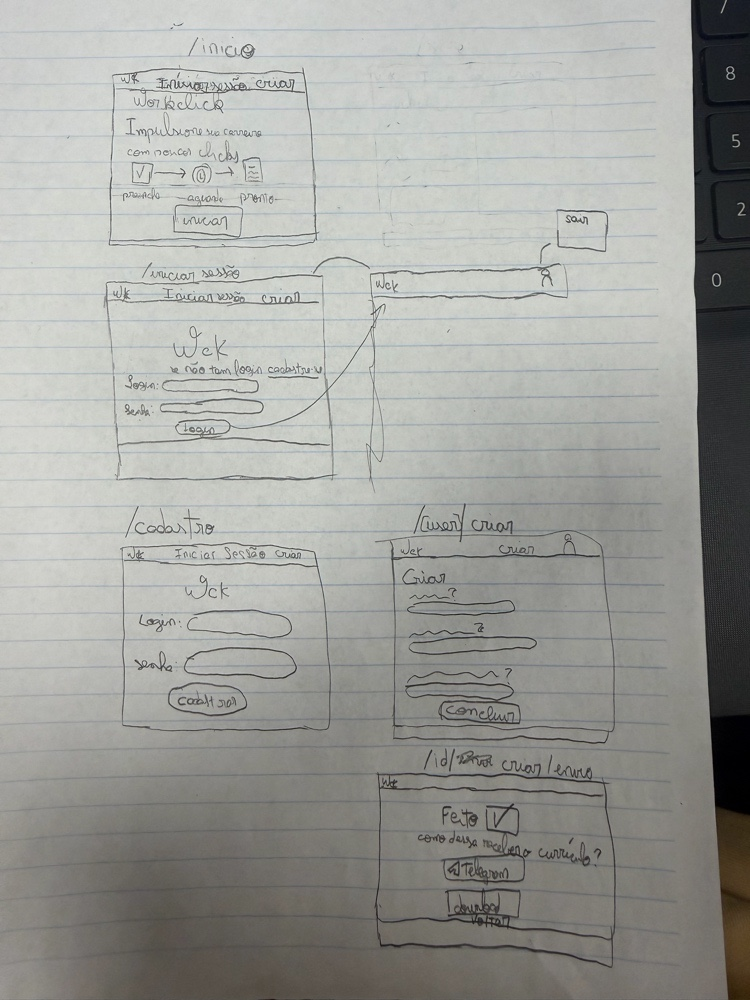

# Worclick - Evolução do projeto

## Objetivo desta etapa

O projeto anterior, na pasta `1_projeto_lagarta`, apresenta o Worclick em HTML, CSS e JavaScript. Nesta etapa, a interface está sendo migrada para React com Next.js: o foco é construir as telas do wireframe, adaptar a experiência para celular e permitir a navegação entre elas.

O formulário agora valida campos obrigatórios e formatos no navegador, permite adicionar e remover experiências profissionais e salva um único currículo no armazenamento local do navegador. A geração do arquivo e o envio para celular ainda não estão implementados.

## Wireframe da jornada



O esboço conecta cinco momentos do uso: apresentação do Worclick, início de sessão, cadastro, preenchimento do currículo e conclusão. Essa sequência dá contexto às rotas e às alterações descritas a seguir. A interface React implementada segue esses momentos; geração e envio são etapas futuras.

## O que esta etapa inclui

- Páginas responsivas para início, sessão, cadastro, preenchimento do currículo e conclusão.
- Navegação entre as telas com o roteamento do Next.js.
- Campos organizados pelos mesmos grupos de informação do formulário HTML original, com validação nativa dos campos obrigatórios e dos formatos de e-mail e URL.
- Inclusão e remoção de experiências profissionais; ao começar a preencher uma experiência, todos os campos dessa entrada tornam-se obrigatórios.
- Salvamento de um único currículo no armazenamento local do navegador. Um novo salvamento substitui o anterior.
- Indicação visual de que download e envio para o celular ainda serão implementados.

## Migração para Next.js

A migração parte dos arquivos `index.html`, `style.css` e `script.js` da pasta `1_projeto_lagarta`. Em vez de concentrar toda a interface em um único documento, o Next.js organiza cada tela em um arquivo `page.js` dentro de uma pasta de rota. O componente `layout.js` compartilha o cabeçalho, a navegação e o rodapé entre essas páginas.

| Projeto HTML/CSS/JS | Projeto React/Next.js |
| --- | --- |
| `index.html` e seus blocos de conteúdo | `src/app/page.js` para o início e páginas próprias para cada rota |
| Elementos repetidos do cabeçalho | `src/app/components/Navegacao.js`, incluído pelo layout compartilhado e estruturado com `header`, `nav`, `ul` e `li` |
| Campos do formulário no HTML | Grupos de campos renderizados em `src/app/curriculo/page.js` |
| `style.css` | `src/app/globals.css` para regras globais e CSS Modules específicos para cada tela e componente |
| Links e navegação da página única | `next/link` e pastas do App Router |
| `script.js` para validar dados e gerar Word | A validação dos formulários usa recursos nativos do HTML; geração do documento e envio ainda não foram migrados |

O visual também foi aproximado do original: o azul `#0056b3` permanece como cor principal, com fundo cinza-claro, áreas de conteúdo brancas, campos com bordas neutras e rodapé grafite. A home conserva a apresentação do Worclick e exemplos decorativos de currículo. O formulário organiza os campos em grupos temáticos e oferece controles para adicionar e remover experiências profissionais. O currículo é único; não há seleção de modelos nem controles para duplicar formações ou projetos.

O App Router associa a pasta ao endereço: `src/app/sessao/page.js` atende `/sessao`; `src/app/cadastro/page.js` atende `/cadastro`; `src/app/curriculo/page.js` atende `/curriculo`; e `src/app/curriculo/concluido/page.js` atende `/curriculo/concluido`. Os componentes de página são React e a navegação usa `Link`, sem recarregar o documento inteiro.

Os formulários de sessão e cadastro usam validação nativa do navegador (nome no cadastro, e-mail válido e senha com pelo menos oito caracteres), mas não autenticam nem armazenam credenciais. Após a validação, seguem para o formulário do currículo. No formulário, nome, título profissional, cidade e e-mail são obrigatórios; campos de e-mail e URL também são validados pelo navegador. Ao salvar, os dados são gravados localmente e a pessoa segue para a conclusão. As opções de baixar e receber o currículo aparecem como próximas etapas, sem executar essas ações.

## 1. Rotas do site

As rotas abaixo representam telas da aplicação. Elas não carregam identificadores ou outros valores na URL. Nesta versão, os dados do currículo são salvos no armazenamento local do navegador; não há sessão de usuário nem envio dos dados a um servidor.

| Rota | Tela | Comportamento |
| --- | --- | --- |
| `/` | Início do site | Apresenta o Worclick e oferece acesso para iniciar uma sessão ou criar um currículo. |
| `/sessao` | Iniciar sessão | Valida e-mail e senha no navegador e segue para a criação do currículo; autenticação ainda não integrada. |
| `/cadastro` | Cadastro | Valida nome, e-mail e senha no navegador e segue para a criação do currículo; cadastro ainda não integrado. |
| `/curriculo` | Criar currículo | Permite preencher os dados, adicionar ou remover experiências e salvar um único currículo no navegador. |
| `/curriculo/concluido` | Conclusão | Confirma o salvamento e apresenta download e envio para celular como próximas etapas. |

O roteador associa cada caminho a uma tela e indica uma tela de não encontrado para caminhos inválidos. Ao acessar diretamente uma dessas rotas, o servidor de hospedagem também deverá entregar a aplicação; caso contrário, a atualização do navegador pode resultar em erro 404.

As rotas não substituem o controle de acesso. Nesta versão, `/curriculo` não exige autenticação e pode ser aberto diretamente; login e cadastro ainda não verificam uma sessão. Se o projeto passar a exigir acesso autenticado, essa proteção deverá ser implementada no servidor e nas rotas. Como as URLs não têm parâmetros, informações como o número de telefone não devem ser colocadas no caminho.

## 2. Navegação das telas

1. A pessoa acessa `/` e escolhe iniciar uma sessão ou fazer o cadastro.
2. Em `/sessao` ou `/cadastro`, preenche os campos e, após a validação nativa, segue para `/curriculo`. Essa etapa não verifica credenciais nem cria uma conta.
3. Em `/curriculo`, preenche os dados pessoais, formação, projetos e competências; pode adicionar ou remover experiências profissionais. Uma experiência parcialmente preenchida exige o preenchimento de todos os seus campos.
4. Ao salvar, o formulário grava um único objeto JSON com a chave `worclick-curriculo` em `localStorage`. Os campos obrigatórios e os formatos inválidos são bloqueados pelo navegador; se o armazenamento falhar, uma mensagem de erro é apresentada.
5. Após o salvamento, a aplicação abre `/curriculo/concluido`. A página confirma a etapa, mas não gera um arquivo nem envia dados para um celular.

O armazenamento é local ao navegador e não equivale a uma conta ou cópia de segurança. Limpar os dados do navegador remove o currículo, e outro dispositivo não tem acesso a ele. Não há servidor recebendo ou sincronizando os dados.

## 3. Próximas etapas: geração e envio

Embora a versão anterior do projeto tenha geração de documento no navegador, essa funcionalidade ainda não está disponível nesta aplicação Next.js. A lógica precisa ser adaptada para React e conectada à ação de download. O envio para celular exigirá uma API no servidor; o navegador não deverá chamar diretamente a API privada do provedor de mensagens nem expor credenciais.

Uma proposta de endpoint do próprio projeto é:

```http
POST /api/curriculos/enviar
Content-Type: multipart/form-data
```

O corpo da requisição pode conter o número de celular e o arquivo do currículo, por exemplo nos campos `telefone` e `curriculo`. O caminho do endpoint é fixo e não possui parâmetro; os dados variáveis seguem no corpo da requisição. Essa API é diferente das rotas de tela `/`, `/sessao` e `/curriculo`.

Quando essa integração for implementada, o servidor deverá:

1. Verificar se o telefone e o arquivo foram enviados e se o formato e o tamanho do documento são permitidos.
2. Normalizar e validar o número, incluindo código do país e DDD.
3. Confirmar que o envio foi solicitado pelo usuário e respeitar os limites do serviço integrado.
4. Encaminhar o documento por uma API de mensagens, como a WhatsApp Business Platform, conforme as regras e configurações da conta do projeto.
5. Responder com um status adequado, sem expor credenciais nem dados pessoais desnecessários.

O formato da mensagem e a configuração do provedor serão definidos nessa etapa futura. O site deverá preservar uma alternativa de download e oferecer nova tentativa em caso de falha.

## 4. Organização do front-end

### React e rotas

- `layout.js` compartilha navegação e rodapé; `Navegacao.js` concentra os links principais.
- `Navegacao.js` usa `header` e `nav` para identificar a navegação principal, com os links em uma lista `ul`/`li`; as páginas priorizam elementos semânticos do HTML5 em vez de wrappers genéricos.
- As páginas usam um único `main` como região principal; seções, cabeçalhos, formulários, grupos de campos e listas usam elementos semânticos como `section`, `header`, `form`, `fieldset`, `label`, `ol` e `li`.
- Cada tela tem seu próprio `page.js`, seguindo a estrutura de pastas do App Router.
- `Acesso.js` reaproveita a composição visual entre início de sessão e cadastro.
- A página de currículo organiza os campos em grupos temáticos, mantém rótulos associados aos controles e permite gerenciar experiências profissionais repetíveis.
- `localStorage` guarda somente um currículo sob a chave `worclick-curriculo`; salvar novamente substitui o registro anterior.
- Os formulários de acesso e cadastro validam os campos no navegador, mas não implementam autenticação ou criação de conta.

### CSS

- `globals.css` define a base visual, tipografia, cores e normalização dos elementos.
- `src/app/page.module.css` contém os estilos exclusivos da página inicial.
- `src/app/curriculo/page.module.css` e `src/app/curriculo/concluido/page.module.css` isolam os estilos do formulário e da página de conclusão.
- `src/app/components/Acesso.module.css`, `Navegacao.module.css` e `Footer.module.css` isolam os estilos dos componentes compartilhados de acesso, cabeçalho e rodapé.
- As regras responsivas ficam junto à tela ou ao componente correspondente; `globals.css` permanece restrito à base global, às variáveis e à normalização.
- As páginas adaptam os exemplos, os grupos do formulário e as ações para telas estreitas, preservando a organização visual do projeto original.

### Limites desta versão

- O currículo é armazenado apenas no navegador, sem sincronização ou persistência no servidor.
- A tela de conclusão não baixa um arquivo nem solicita o número de celular.
- Login e cadastro validam os campos no navegador, mas não autenticam usuários nem criam contas.

## 5. Privacidade e segurança nas próximas etapas

Currículos contêm dados pessoais. Nesta versão, os dados do currículo ficam no `localStorage` do navegador e podem ser acessados por quem usa o mesmo perfil do navegador; evite salvar informações sensíveis em dispositivos compartilhados. Uma integração futura deverá solicitar somente os dados necessários, informar a finalidade do telefone, obter confirmação antes do envio e limitar o tempo de armazenamento do arquivo. O documento não deve ficar disponível em um endereço público previsível. A comunicação com o servidor e com o provedor deve usar HTTPS, e as credenciais da integração devem permanecer no servidor.

Antes de disponibilizar o envio, também será necessário verificar as regras atuais do provedor escolhido, incluindo consentimento, formatos aceitos e eventuais modelos de mensagem exigidos.

## 6. Verificações desta etapa

- Acessar diretamente `/`, `/sessao`, `/cadastro`, `/curriculo` e `/curriculo/concluido`.
- Percorrer os links da página inicial, alternar entre sessão e cadastro e avançar até o formulário.
- Confirmar que os campos obrigatórios do currículo e do acesso são validados pelo navegador, incluindo formatos inválidos de e-mail e URL.
- Adicionar e remover experiências; verificar que uma experiência parcialmente preenchida exige todos os seus campos e que uma experiência vazia pode ser omitida.
- Salvar um currículo e conferir `localStorage` sob a chave `worclick-curriculo`; salvar outro e confirmar que o registro anterior foi substituído.
- Confirmar que uma falha no armazenamento apresenta uma mensagem e não avança para a conclusão.
- Confirmar que a página final identifica download e envio para celular como ações futuras.
- Verificar a leitura e o uso dos campos em larguras de celular e desktop.
